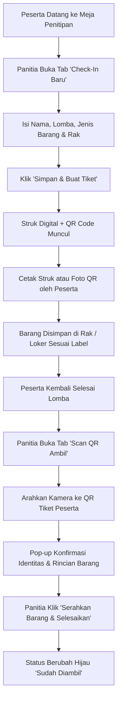

# 🎒 Sistem Penitipan Barang & Registrasi Digital (Digital Cloakroom System)
> **PCC Event & Organisasi / Boothcamp**

Aplikasi web modern, responsif (*mobile-friendly*), dan intuitif untuk mengelola penitipan barang peserta lomba/acara secara digital menggunakan **Nomor Tiket Otomatis** dan **Pemindai Kode QR Kamera**.

### 6. 🎨 Skema Desain & Palet Warna (*Fresh Forest & Neon Theme*)
Aplikasi menggunakan skema warna hijau alami modern berbasis palet 5-warna:
- **`#186301` (Dark Pine)**: Warna dominan untuk header, judul, gradien tombol utama, dan teks penting.
- **`#297810` (Deep Foliage)**: Warna interaktif utama (tombol aksi, active state, border fokus).
- **`#49a141` (Leaf Green)**: Warna ikon, badge serah terima, tombol scan kamera.
- **`#77d26f` (Mint Sage)**: Warna aksen lembut, border kartu, tag pills, dan bingkai tiket.
- **`#2fff00` (Electric Neon Lime)**: Garis animasi laser pemindai kamera dan lampu indikator sistem aktif (*live pulse*).

---

## 💡 Tips & Solusi Jika QR Code Sulit / Tidak Bisa Di-scan

Jika Anda mengalami kendala saat memindai QR Code, perhatikan 3 hal berikut:

1. **Akses Kamera di Browser (Izin Kamera)**:
   - Browser modern (Chrome, Edge, Safari) membatasi akses kamera perangkat jika berkas dibuka langsung lewat `file://` (klik ganda file HTML).
   - **Solusi**: Jalankan aplikasi melalui **Live Server** di VS Code atau jalankan perintah:
     ```powershell
     python -m http.server 8080
     ```
     Lalu buka `http://localhost:8080` di browser Anda.

2. **Fitur "Scan Foto QR" (Tanpa Perlu Kamera Fisik)**:
   - Jika Anda sedang menguji coba di satu laptop/layar dan tidak punya perangkat kedua, buka struk tiket lalu klik **"Unduh Gambar QR"**.
   - Masuk ke tab **Scan QR Ambil**, lalu klik tombol **"📁 Scan Foto QR"** dan pilih gambar QR yang baru diunduh. Sistem akan langsung memprosesnya secara instan!

3. **Fitur "Simulasi Cepat"**:
   - Di tab **Scan QR Ambil**, terdapat dropdown **Simulasi Cepat**. Anda cukup memilih nomor tiket aktif dan klik **"Uji Scan"** untuk melihat alur serah terima barang tanpa kamera.

4. **Kualitas Tampilan QR Code**:
   - Kode QR kini telah dioptimasi dengan format modul besar (densitas rendah / *Level M*), sehingga sangat mudah terbaca oleh kamera HP/webcam bahkan dari jarak jauh dan kondisi cahaya redup.

### 6. 🎨 Skema Desain & Palet Warna (*Fresh Forest & Neon Theme*)
Aplikasi menggunakan skema warna hijau alami modern berbasis palet 5-warna:
- **`#186301` (Dark Pine)**: Warna dominan untuk header, judul, gradien tombol utama, dan teks penting.
- **`#297810` (Deep Foliage)**: Warna interaktif utama (tombol aksi, active state, border fokus).
- **`#49a141` (Leaf Green)**: Warna ikon, badge serah terima, tombol scan kamera.
- **`#77d26f` (Mint Sage)**: Warna aksen lembut, border kartu, tag pills, dan bingkai tiket.
- **`#2fff00` (Electric Neon Lime)**: Garis animasi laser pemindai kamera dan lampu indikator sistem aktif (*live pulse*).

---

## 🌟 Fitur Utama

### 1. 📝 Registrasi & Check-In Penitipan Barang
- **Input Data Lengkap**: Nama Peserta, Kategori Lomba (*Dropdown*), Kontak WhatsApp (opsional), Lokasi Rak/Loker, Catatan Tambahan.
- **Pilihan Cepat Jenis Barang (*Quick Pills*)**: Klik satu tombol untuk menambahkan tas ransel, laptop, tumbler, payung, jaket, helm, dll.
- **Generator Nomor Tiket Otomatis**: Menghasilkan nomor berurutan dengan format profesional (`TIK-001`, `TIK-002`, dst.).

### 2. 🖨️ Struk Digital, Kode QR & Pengiriman Otomatis ke Email
- **Modal Tiket Digital Pop-up**: Langsung muncul otomatis setelah data disimpan.
- **⚡ Pengiriman Email 100% Otomatis (Zero-Click)**:
  * Begitu tombol *"Simpan & Buat Tiket"* diklik, sistem **secara otomatis di latar belakang langsung mengirimkan struk ke alamat email peserta**.
  * Email yang diterima peserta memuat **Gambar Kode QR Utuh**, Nomor Tiket, Identitas, Rincian Barang, dan Lokasi Rak.
  * Berkas **PDF Struk Resmi** (`.pdf`) juga secara otomatis terunduh ke perangkat.
- **Dua Pilihan Penyedia Email (Menu Opsi ➔ Pengaturan Email)**:
  1. **Google Apps Script (Direkomendasikan - Paling Mudah)**:
     * Menggunakan akun Gmail panitia langsung, 100% gratis, tanpa perlu daftar akun pihak ketiga.
     * Cukup salin kode script yang telah disediakan (`google_apps_script.js`), deploy di [script.google.com](https://script.google.com), lalu tempelkan URL Web App-nya.
  2. **EmailJS**:
     * Untuk pengguna yang telah memiliki akun [emailjs.com](https://www.emailjs.com), masukkan Service ID, Template ID, dan Public Key Anda.
- **💬 Kirim Bukti via WhatsApp**: Tombol satu-klik untuk mengirimkan struk konfirmasi langsung ke nomor WhatsApp peserta.
- **Cetak Struk Khusus (*Thermal Receipt & Kertas*)**: Dilengkapi CSS `@media print` terformat rapi untuk printer thermal ukuran 58mm/80mm maupun kertas standar.

### 3. 📷 Pemindai Kode QR Kamera (*QR Scanner Integration*)
- Menggunakan library **HTML5 QR Code**.
- Dukungan pemilihan kamera (Kamera Depan / Kamera Belakang Smartphone & Tablet).
- Animasi garis laser & *audio feedback* (suara *beep*) saat scan berhasil.
- Pop-up konfirmasi status barang otomatis saat QR dipindai.

### 4. 🤝 Pengambilan Barang (*Check-Out*)
- **Pencarian Ganda**: Verifikasi lewat Scan QR Kamera **atau** pencarian manual (Nomor Tiket / Nama Peserta).
- **Aksi Cepat Serahkan Barang**: Mengubah status dari `Dititipkan` (Kuning) menjadi `Sudah Diambil` (Hijau) beserta pencatatan otomatis waktu pengambilan.
- **Fitur Undo**: Membatalkan status jika panitia tidak sengaja salah klik.

### 5. 📊 Dashboard Statistik Real-Time & Riwayat
- Kartu ringkasan: **Barang Sedang Dititipkan**, **Sudah Diambil**, dan **Total Keseluruhan**.
- Filter tabel berdasarkan Status (*Semua*, *Dititipkan*, *Diambil*) dan Kategori Lomba.
- Pencarian instan (*live search*).
- Tampilan tabel responsif untuk Laptop dan Card View untuk HP/Tablet.

### 6. 💾 Penyimpanan & Utilitas
- Data tersimpan aman di `localStorage` peramban (data tidak hilang saat refresh).
- Fitur **Ekspor ke CSV/Excel** (*BOM UTF-8 ready*).
- Fitur **Muat Data Demo** dan **Kosongkan Data**.

### 6. 🎨 Skema Desain & Palet Warna (*Fresh Forest & Neon Theme*)
Aplikasi menggunakan skema warna hijau alami modern berbasis palet 5-warna:
- **`#186301` (Dark Pine)**: Warna dominan untuk header, judul, gradien tombol utama, dan teks penting.
- **`#297810` (Deep Foliage)**: Warna interaktif utama (tombol aksi, active state, border fokus).
- **`#49a141` (Leaf Green)**: Warna ikon, badge serah terima, tombol scan kamera.
- **`#77d26f` (Mint Sage)**: Warna aksen lembut, border kartu, tag pills, dan bingkai tiket.
- **`#2fff00` (Electric Neon Lime)**: Garis animasi laser pemindai kamera dan lampu indikator sistem aktif (*live pulse*).

---

## 💡 Tips & Solusi Jika QR Code Sulit / Tidak Bisa Di-scan

Jika Anda mengalami kendala saat memindai QR Code, perhatikan 3 hal berikut:

1. **Akses Kamera di Browser (Izin Kamera)**:
   - Browser modern (Chrome, Edge, Safari) membatasi akses kamera perangkat jika berkas dibuka langsung lewat `file://` (klik ganda file HTML).
   - **Solusi**: Jalankan aplikasi melalui **Live Server** di VS Code atau jalankan perintah:
     ```powershell
     python -m http.server 8080
     ```
     Lalu buka `http://localhost:8080` di browser Anda.

2. **Fitur "Scan Foto QR" (Tanpa Perlu Kamera Fisik)**:
   - Jika Anda sedang menguji coba di satu laptop/layar dan tidak punya perangkat kedua, buka struk tiket lalu klik **"Unduh Gambar QR"**.
   - Masuk ke tab **Scan QR Ambil**, lalu klik tombol **"📁 Scan Foto QR"** dan pilih gambar QR yang baru diunduh. Sistem akan langsung memprosesnya secara instan!

3. **Fitur "Simulasi Cepat"**:
   - Di tab **Scan QR Ambil**, terdapat dropdown **Simulasi Cepat**. Anda cukup memilih nomor tiket aktif dan klik **"Uji Scan"** untuk melihat alur serah terima barang tanpa kamera.

4. **Kualitas Tampilan QR Code**:
   - Kode QR kini telah dioptimasi dengan format modul besar (densitas rendah / *Level M*), sehingga sangat mudah terbaca oleh kamera HP/webcam bahkan dari jarak jauh dan kondisi cahaya redup.

### 6. 🎨 Skema Desain & Palet Warna (*Fresh Forest & Neon Theme*)
Aplikasi menggunakan skema warna hijau alami modern berbasis palet 5-warna:
- **`#186301` (Dark Pine)**: Warna dominan untuk header, judul, gradien tombol utama, dan teks penting.
- **`#297810` (Deep Foliage)**: Warna interaktif utama (tombol aksi, active state, border fokus).
- **`#49a141` (Leaf Green)**: Warna ikon, badge serah terima, tombol scan kamera.
- **`#77d26f` (Mint Sage)**: Warna aksen lembut, border kartu, tag pills, dan bingkai tiket.
- **`#2fff00` (Electric Neon Lime)**: Garis animasi laser pemindai kamera dan lampu indikator sistem aktif (*live pulse*).

---

## 📁 Struktur Berkas

```
tempat penitipan/
├── index.html     # Halaman utama aplikasi, layout antarmuka & modal
├── style.css      # Styling khusus, animasi laser scan, dan cetak struk thermal
├── app.js         # Logika penyimpanan, QR generator, QR scanner & validasi
└── README.md      # Dokumentasi sistem & panduan penggunaan panitia
```

### 6. 🎨 Skema Desain & Palet Warna (*Fresh Forest & Neon Theme*)
Aplikasi menggunakan skema warna hijau alami modern berbasis palet 5-warna:
- **`#186301` (Dark Pine)**: Warna dominan untuk header, judul, gradien tombol utama, dan teks penting.
- **`#297810` (Deep Foliage)**: Warna interaktif utama (tombol aksi, active state, border fokus).
- **`#49a141` (Leaf Green)**: Warna ikon, badge serah terima, tombol scan kamera.
- **`#77d26f` (Mint Sage)**: Warna aksen lembut, border kartu, tag pills, dan bingkai tiket.
- **`#2fff00` (Electric Neon Lime)**: Garis animasi laser pemindai kamera dan lampu indikator sistem aktif (*live pulse*).

---

## 💡 Tips & Solusi Jika QR Code Sulit / Tidak Bisa Di-scan

Jika Anda mengalami kendala saat memindai QR Code, perhatikan 3 hal berikut:

1. **Akses Kamera di Browser (Izin Kamera)**:
   - Browser modern (Chrome, Edge, Safari) membatasi akses kamera perangkat jika berkas dibuka langsung lewat `file://` (klik ganda file HTML).
   - **Solusi**: Jalankan aplikasi melalui **Live Server** di VS Code atau jalankan perintah:
     ```powershell
     python -m http.server 8080
     ```
     Lalu buka `http://localhost:8080` di browser Anda.

2. **Fitur "Scan Foto QR" (Tanpa Perlu Kamera Fisik)**:
   - Jika Anda sedang menguji coba di satu laptop/layar dan tidak punya perangkat kedua, buka struk tiket lalu klik **"Unduh Gambar QR"**.
   - Masuk ke tab **Scan QR Ambil**, lalu klik tombol **"📁 Scan Foto QR"** dan pilih gambar QR yang baru diunduh. Sistem akan langsung memprosesnya secara instan!

3. **Fitur "Simulasi Cepat"**:
   - Di tab **Scan QR Ambil**, terdapat dropdown **Simulasi Cepat**. Anda cukup memilih nomor tiket aktif dan klik **"Uji Scan"** untuk melihat alur serah terima barang tanpa kamera.

4. **Kualitas Tampilan QR Code**:
   - Kode QR kini telah dioptimasi dengan format modul besar (densitas rendah / *Level M*), sehingga sangat mudah terbaca oleh kamera HP/webcam bahkan dari jarak jauh dan kondisi cahaya redup.

### 6. 🎨 Skema Desain & Palet Warna (*Fresh Forest & Neon Theme*)
Aplikasi menggunakan skema warna hijau alami modern berbasis palet 5-warna:
- **`#186301` (Dark Pine)**: Warna dominan untuk header, judul, gradien tombol utama, dan teks penting.
- **`#297810` (Deep Foliage)**: Warna interaktif utama (tombol aksi, active state, border fokus).
- **`#49a141` (Leaf Green)**: Warna ikon, badge serah terima, tombol scan kamera.
- **`#77d26f` (Mint Sage)**: Warna aksen lembut, border kartu, tag pills, dan bingkai tiket.
- **`#2fff00` (Electric Neon Lime)**: Garis animasi laser pemindai kamera dan lampu indikator sistem aktif (*live pulse*).

---

## 🚀 Cara Menjalankan Aplikasi

Aplikasi ini bersifat **Client-Side (Stand-alone)** tanpa perlu instalasi database atau backend rumit:

1. **Buka Langsung di Browser**:
   - Cukup klik dua kali berkas `index.html` pada browser modern (Google Chrome, Microsoft Edge, Safari, Firefox).
   - *Catatan untuk fitur Kamera*: Browser modern membutuhkan konteks aman (*HTTPS* atau *localhost*) untuk mengaktifkan izin kamera perangkat.
2. **Menjalankan via Local Server (Sangat Disarankan)**:
   - Jika menggunakan **VS Code**: Klik kanan pada `index.html` lalu pilih **Open with Live Server**.
   - Atau menggunakan terminal PowerShell di folder ini:
     ```powershell
     python -m http.server 8080
     ```
     Lalu buka `http://localhost:8080` di browser Anda.

### 6. 🎨 Skema Desain & Palet Warna (*Fresh Forest & Neon Theme*)
Aplikasi menggunakan skema warna hijau alami modern berbasis palet 5-warna:
- **`#186301` (Dark Pine)**: Warna dominan untuk header, judul, gradien tombol utama, dan teks penting.
- **`#297810` (Deep Foliage)**: Warna interaktif utama (tombol aksi, active state, border fokus).
- **`#49a141` (Leaf Green)**: Warna ikon, badge serah terima, tombol scan kamera.
- **`#77d26f` (Mint Sage)**: Warna aksen lembut, border kartu, tag pills, dan bingkai tiket.
- **`#2fff00` (Electric Neon Lime)**: Garis animasi laser pemindai kamera dan lampu indikator sistem aktif (*live pulse*).

---

## 💡 Tips & Solusi Jika QR Code Sulit / Tidak Bisa Di-scan

Jika Anda mengalami kendala saat memindai QR Code, perhatikan 3 hal berikut:

1. **Akses Kamera di Browser (Izin Kamera)**:
   - Browser modern (Chrome, Edge, Safari) membatasi akses kamera perangkat jika berkas dibuka langsung lewat `file://` (klik ganda file HTML).
   - **Solusi**: Jalankan aplikasi melalui **Live Server** di VS Code atau jalankan perintah:
     ```powershell
     python -m http.server 8080
     ```
     Lalu buka `http://localhost:8080` di browser Anda.

2. **Fitur "Scan Foto QR" (Tanpa Perlu Kamera Fisik)**:
   - Jika Anda sedang menguji coba di satu laptop/layar dan tidak punya perangkat kedua, buka struk tiket lalu klik **"Unduh Gambar QR"**.
   - Masuk ke tab **Scan QR Ambil**, lalu klik tombol **"📁 Scan Foto QR"** dan pilih gambar QR yang baru diunduh. Sistem akan langsung memprosesnya secara instan!

3. **Fitur "Simulasi Cepat"**:
   - Di tab **Scan QR Ambil**, terdapat dropdown **Simulasi Cepat**. Anda cukup memilih nomor tiket aktif dan klik **"Uji Scan"** untuk melihat alur serah terima barang tanpa kamera.

4. **Kualitas Tampilan QR Code**:
   - Kode QR kini telah dioptimasi dengan format modul besar (densitas rendah / *Level M*), sehingga sangat mudah terbaca oleh kamera HP/webcam bahkan dari jarak jauh dan kondisi cahaya redup.

### 6. 🎨 Skema Desain & Palet Warna (*Fresh Forest & Neon Theme*)
Aplikasi menggunakan skema warna hijau alami modern berbasis palet 5-warna:
- **`#186301` (Dark Pine)**: Warna dominan untuk header, judul, gradien tombol utama, dan teks penting.
- **`#297810` (Deep Foliage)**: Warna interaktif utama (tombol aksi, active state, border fokus).
- **`#49a141` (Leaf Green)**: Warna ikon, badge serah terima, tombol scan kamera.
- **`#77d26f` (Mint Sage)**: Warna aksen lembut, border kartu, tag pills, dan bingkai tiket.
- **`#2fff00` (Electric Neon Lime)**: Garis animasi laser pemindai kamera dan lampu indikator sistem aktif (*live pulse*).

---

## 📋 Alur Kerja Panitia di Lapangan



### 6. 🎨 Skema Desain & Palet Warna (*Fresh Forest & Neon Theme*)
Aplikasi menggunakan skema warna hijau alami modern berbasis palet 5-warna:
- **`#186301` (Dark Pine)**: Warna dominan untuk header, judul, gradien tombol utama, dan teks penting.
- **`#297810` (Deep Foliage)**: Warna interaktif utama (tombol aksi, active state, border fokus).
- **`#49a141` (Leaf Green)**: Warna ikon, badge serah terima, tombol scan kamera.
- **`#77d26f` (Mint Sage)**: Warna aksen lembut, border kartu, tag pills, dan bingkai tiket.
- **`#2fff00` (Electric Neon Lime)**: Garis animasi laser pemindai kamera dan lampu indikator sistem aktif (*live pulse*).

---

## 💡 Tips & Solusi Jika QR Code Sulit / Tidak Bisa Di-scan

Jika Anda mengalami kendala saat memindai QR Code, perhatikan 3 hal berikut:

1. **Akses Kamera di Browser (Izin Kamera)**:
   - Browser modern (Chrome, Edge, Safari) membatasi akses kamera perangkat jika berkas dibuka langsung lewat `file://` (klik ganda file HTML).
   - **Solusi**: Jalankan aplikasi melalui **Live Server** di VS Code atau jalankan perintah:
     ```powershell
     python -m http.server 8080
     ```
     Lalu buka `http://localhost:8080` di browser Anda.

2. **Fitur "Scan Foto QR" (Tanpa Perlu Kamera Fisik)**:
   - Jika Anda sedang menguji coba di satu laptop/layar dan tidak punya perangkat kedua, buka struk tiket lalu klik **"Unduh Gambar QR"**.
   - Masuk ke tab **Scan QR Ambil**, lalu klik tombol **"📁 Scan Foto QR"** dan pilih gambar QR yang baru diunduh. Sistem akan langsung memprosesnya secara instan!

3. **Fitur "Simulasi Cepat"**:
   - Di tab **Scan QR Ambil**, terdapat dropdown **Simulasi Cepat**. Anda cukup memilih nomor tiket aktif dan klik **"Uji Scan"** untuk melihat alur serah terima barang tanpa kamera.

4. **Kualitas Tampilan QR Code**:
   - Kode QR kini telah dioptimasi dengan format modul besar (densitas rendah / *Level M*), sehingga sangat mudah terbaca oleh kamera HP/webcam bahkan dari jarak jauh dan kondisi cahaya redup.

### 6. 🎨 Skema Desain & Palet Warna (*Fresh Forest & Neon Theme*)
Aplikasi menggunakan skema warna hijau alami modern berbasis palet 5-warna:
- **`#186301` (Dark Pine)**: Warna dominan untuk header, judul, gradien tombol utama, dan teks penting.
- **`#297810` (Deep Foliage)**: Warna interaktif utama (tombol aksi, active state, border fokus).
- **`#49a141` (Leaf Green)**: Warna ikon, badge serah terima, tombol scan kamera.
- **`#77d26f` (Mint Sage)**: Warna aksen lembut, border kartu, tag pills, dan bingkai tiket.
- **`#2fff00` (Electric Neon Lime)**: Garis animasi laser pemindai kamera dan lampu indikator sistem aktif (*live pulse*).

---
*Dibuat untuk Organisasi & UKM PCC - Digital Cloakroom System*
